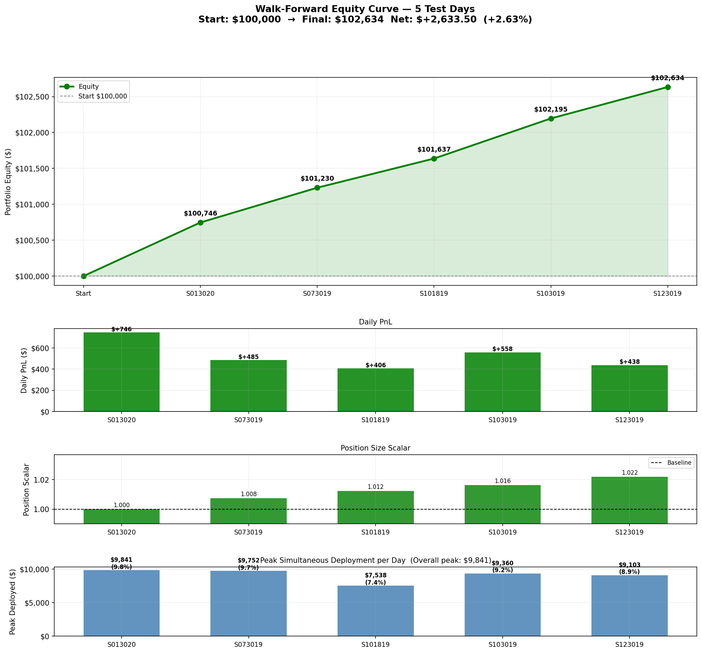
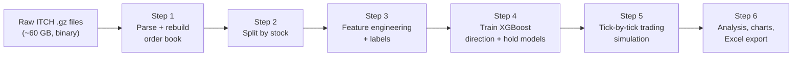
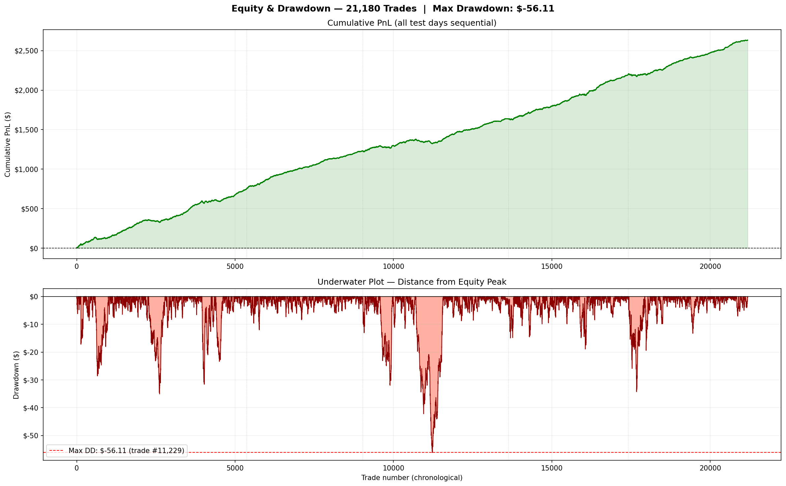
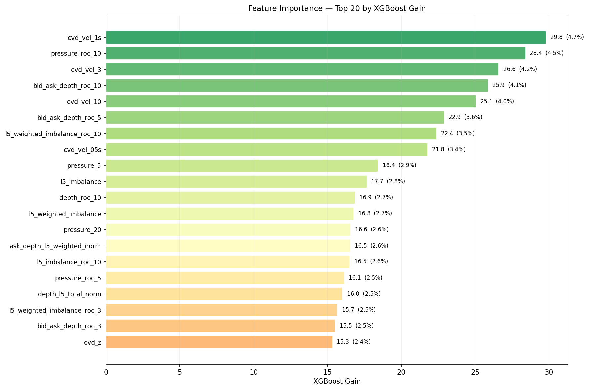
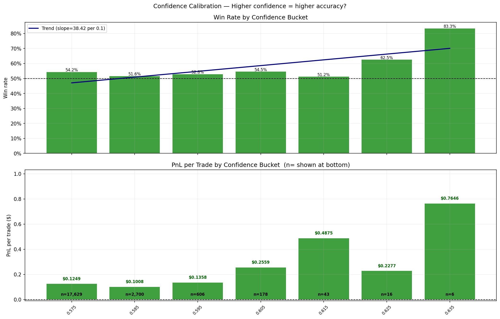

# CVD Pipeline: Order-Flow Trading Model on NASDAQ ITCH Tick Data

An end-to-end machine learning pipeline that reads **raw NASDAQ exchange data at the individual-order level**, rebuilds the live order book for 30 high-volume NASDAQ stocks, engineers order-flow features centered on **Cumulative Volume Delta (CVD)**, trains **XGBoost** models to predict short-term price moves, and then **simulates trading** those predictions tick by tick on days the model never saw.

The pipeline processes roughly **60 GB of real-world NASDAQ TotalView-ITCH 5.0 data** and turns it into a trade log, an equity curve, and a full set of diagnostic charts.



---

## Results at a Glance

Out-of-sample simulation on 5 held-out trading days, starting with $100,000 of simulated equity:

| Metric | Result |
|---|---|
| Simulated trades | 21,180 |
| Net profit | +$2,633.50 (+2.63% of total equity) |
| Peak capital deployed at once | $9,841 (9.8% of equity) |
| Return on peak deployed capital | **26.8%** |
| Win rate | 53.9% |
| Profit factor | 1.58 |
| Max drawdown | −$56.96 |
| Profitable test days | 5 of 5 |
| Symbols traded | 29 (27 profitable) |

Results are **gross**: commissions, exchange fees, spread costs and slippage are not modeled yet. See [Limitations](#limitations-and-next-steps).

---

## The Idea: Why Order Flow?

Every trade on an exchange has two sides, and one side is always the **aggressor**: the trader who crossed the spread to get filled immediately. A buyer lifting the ask is aggressive buying; a seller hitting the bid is aggressive selling.

**Cumulative Volume Delta (CVD)** tracks the running total of aggressive buy volume minus aggressive sell volume:

```
delta(trade) = +shares   if the buyer was the aggressor
               −shares   if the seller was the aggressor

CVD(t) = sum of delta over all trades up to time t
```

When CVD rises quickly, buyers are paying up urgently; when it falls, sellers are. Combined with the shape of the **order book** (how many shares are waiting at each price level on the bid and ask), this gives a picture of supply and demand pressure *before* it fully shows up in price. This project tests whether those order-flow signals can predict very short-term price moves well enough to trade.

Most retail data only provides price bars (open, high, low, close, volume). This project goes to the raw exchange feed instead, so it can see **every order, every cancel, and which side started each trade**.

---

## How It Works



### Step 1: Parse raw exchange data and rebuild the order book (`step1_itch_parser.py`)

NASDAQ TotalView-ITCH 5.0 is the exchange's binary message feed. Each trading day is one compressed file containing hundreds of millions of messages. The parser decodes each message type byte by byte:

| Message | Meaning | What the parser does |
|---|---|---|
| `A` / `F` | New order added | Adds shares at that price to the bid or ask side of the book |
| `X` | Partial cancel | Removes shares from the order |
| `D` | Full delete | Removes the order from the book |
| `U` | Replace | Swaps an order for a new one at a new price and size |
| `E` / `C` | Order executed | **Records a trade.** The aggressor is the opposite side of the resting order that got filled |
| `P` | Hidden (non-displayed) trade | Records a trade with its reported side |

For the 30 target stocks it maintains a live **limit order book**, and at every trade it writes a row containing the trade price, size, aggressor side, and a **5-level depth snapshot**: the top 5 bid and ask prices and sizes, plus derived measures such as total depth, distance-weighted depth, and bid/ask **imbalance** (bid size minus ask size, divided by their sum).

Engineering details: an order-reference lookup table gives O(1) access to any resting order, large read and write buffers speed up decompression and output, and files are processed in parallel across CPU cores.

**Stock universe:** 30 high-volume, NASDAQ-listed stocks with deep order books and prices above $10, including AAPL, MSFT, AMZN, NVDA, TSLA, AMD, INTC, NFLX, ADBE, COST and others.

### Step 2: Split by stock (`step2_stock_splitter.py`)

Splits each day's combined trade file into one file per stock per day, keeping the train / validation / test tag from the folder the source file came from.

### Step 3: Feature engineering and labels (`step3_feature_engineering.py`)

Only regular trading hours (9:30 to 16:00) are used. For every trade, the script builds **41 pure order-flow features**. There are deliberately **no price-level or time-of-day features**, so the model has to learn from order flow alone.

| Feature group | Examples | What it captures |
|---|---|---|
| **CVD velocity** | `cvd_vel_05s`, `cvd_vel_1s`, `cvd_vel_3` … `cvd_vel_20` | How fast CVD changed over the last 0.5 s, 1 s, and 3 to 20 three-second buckets |
| **CVD acceleration / z-score** | `cvd_accel`, `cvd_z` | Whether buying/selling urgency is speeding up, and how unusual current CVD is versus recent history |
| **Pressure** | `pressure_3` … `pressure_20` | Share of aggressive buying vs selling over the last N trades, from −1 (all sells) to +1 (all buys) |
| **Pressure rate of change** | `pressure_roc_5`, `pressure_roc_10` | How quickly that pressure is shifting |
| **Intensity** | `intensity_5`, `intensity_10` | Current trading volume relative to its recent median |
| **Order book depth** | `depth_l5_total_norm`, `bid_depth_l5_weighted_norm` … | How much liquidity is resting in the book, normalized to recent levels |
| **Depth change** | `depth_roc_*`, `bid_ask_depth_roc_*` | Liquidity being added or pulled, and on which side |
| **Book imbalance** | `l1_imbalance`, `l5_weighted_imbalance`, plus their rates of change and acceleration | Whether the book is stacked toward buyers or sellers, and how that is changing |

All features are **causal**: each one uses only information available at or before that trade, so there is no look-ahead.

**Labels.** For each trade, the script looks ahead up to a dynamic window (10 to 30 trades, scaled to how actively that stock trades):

- **Up (+1)** if price rises by **0.05% of the entry price** before it falls by the same amount
- **Down (−1)** if it falls by 0.05% first
- **Flat (0)** if neither happens in the window

The threshold is a percentage rather than a fixed dollar amount, so a $50 stock and a $1,800 stock are labeled consistently. The number of trades it took to hit the threshold is also saved, as the target for the hold-time model.

**Sample weights** emphasize rows with strong pressure, fast CVD movement, and thin books, so training focuses on the situations the strategy is meant to trade.

### Step 4: Train the models (`step4_train_model.py`)

Two XGBoost models are trained on the training days, with the validation day used for **early stopping** to prevent overfitting:

1. **Direction classifier.** Predicts up / flat / down and outputs a probability for each, which becomes the model's **confidence**.
2. **Hold-time regressor.** Predicts how many trades a move is likely to take.

Both models use shallow trees (depth 4), row and column subsampling, and L1/L2 regularization. Feature importance by gain is saved for analysis.

**Data split:** 4 training days, 1 validation day, and 5 test days. The split is set entirely by which folder each raw file is placed in; nothing in the code needs to change.

### Step 5: Trading simulation (`step5_simulate.py`)

The trained model is run over each test day, and every trade is replayed **in true timestamp order across all 29 stocks at once**, with a shared pool of capital.

**Entry rules**

- Only **long** (buy) signals are traded.
- The model's confidence must be at least 0.575. Signals are routed into **confidence bands** that set position size:

| Band | Confidence | Position size |
|---|---|---|
| Band 2 (base) | 0.575 to 0.60 | 2.5% of equity |
| Band 3 (moderate) | 0.60 to 0.65 | 5.0% of equity |
| Band 4 (strong) | 0.65 to 0.70 | 3.0% of equity |

- Signals are skipped if order flow is flat (both pressure change and book imbalance near zero) or if pressure is already moving against the trade.
- Very high-confidence signals (0.70 and above) are ignored as likely outliers.
- Orders fill at the **next trade's price**, never at the price of the trade that generated the signal, to avoid an unrealistically perfect fill.

**Exit rules** (whichever happens first)

- **Take profit:** price moves up 0.05%, matching the label threshold.
- **Stop loss:** price moves down 1.0%.
- **Pressure exit:** buying pressure reverses past a band-specific threshold, so the trade is closed early.
- **Time exit:** the position has been held for its maximum number of trades.
- **End of day:** every position is closed at the close; nothing is held overnight.

**Risk limits:** no single position larger than 10% of equity, at most 90% of equity deployed at once, and position sizes scale with equity as it grows. In practice the strategy never had more than **$9,841** deployed at one time.

### Step 6: Analysis (`step6_model_analysis.py`)

Produces a written summary and 13 charts covering performance from every angle: the equity curve, drawdowns, daily results, confidence bands, confidence calibration, feature importance, time of day, per-symbol results, trade characteristics, and rolling stability. It also exports every simulated trade to a color-coded Excel workbook.

---

## Results in Detail

### Daily performance

| Test day | Trades | P&L | Win rate | Profit factor |
|---|---|---|---|---|
| Jan 30, 2020 | 5,360 | +$745.71 | 54.5% | 1.59 |
| Jul 30, 2019 | 3,669 | +$484.58 | 53.7% | 1.70 |
| Oct 18, 2019 | 4,599 | +$406.50 | 52.6% | 1.39 |
| Oct 30, 2019 | 3,780 | +$558.27 | 55.3% | 1.67 |
| Dec 30, 2019 | 3,772 | +$438.43 | 53.0% | 1.58 |

Every test day was profitable, and the largest drawdown across all 21,180 trades was under $57.



### What drives the model

The most important features are **short-horizon CVD velocity** (how fast aggressive buying is building over the last 0.5 to 3 seconds), **pressure rate of change**, and **changes in bid vs ask depth**. That supports the project's core idea: the speed and direction of aggressive order flow carries short-term predictive information.



### Confidence matters

Higher model confidence lines up with better trades. Win rate rises from about 54% in the lowest band to 68% between 0.625 and 0.65 confidence, and profit per trade rises with it. Very few signals reach the high-confidence range, which is the main constraint on scaling the strategy up.



### More findings

- **Liquidity helps.** The 15 most actively traded stocks earned a profit factor of 1.88, versus 1.27 for the 15 least active (`tick_frequency_analysis.png`).
- **The edge is stronger later in the day.** Profit factor rises steadily from 1.35 at the open to 1.87 near the close (`session_progress.png`).
- **The edge is stable but not constant.** A rolling 200-trade window stays profitable most of the time, with a few short negative stretches (`rolling_metrics.png`).
- **How trades end.** Take-profit exits (2,846 trades) produced +$3,488. Pressure exits (18,331 trades) cut losers early, with a net of −$855. The median holding period was 10 trades.

---

## Limitations and Next Steps

This is a research project, and these points matter when reading the results:

- **No transaction costs.** Average profit is about $0.12 per trade, so commissions, fees, the bid-ask spread and slippage could remove much or all of the edge. Adding a realistic cost model is the most important next step.
- **Small number of days.** 5 test days is a limited sample. Training and test days also come from different periods (2019 to 2021) rather than a strict rolling train-then-test sequence.
- **Long only.** Short signals are generated by the model but not traded yet.
- **Tick-level accuracy is low.** The direction model's accuracy across *every* tick is low; the edge comes from the small, filtered set of confident long signals the strategy actually trades.
- **Next steps:** add costs and slippage, test on many more days with a strict chronological walk-forward split, add short trades, and compare against simple baselines.

---

## Tech Stack

Python, XGBoost, Pandas, NumPy, Matplotlib, multiprocessing, binary protocol parsing (`struct`, `gzip`)

---

## Requirements

Python 3.9+ recommended.

Install dependencies:
```bash
pip install xgboost pandas numpy matplotlib
```

---

## Setup (One Step)

Open `config.py` and change the `BASE` path to wherever your data lives:

```python
# Windows
BASE = r"E:\CVD data"

# Mac / Linux
BASE = "/home/yourname/cvd_data"
```

That is the **only file you need to edit**. Every step imports its paths from `config.py`.

---

## Folder Structure

Create this folder structure under your `BASE` directory before running.  
The pipeline will auto-create subfolders it writes to; you only need to create the source data folders.

```
<BASE>/
│
├── Data/
│   └── Tick/
│       ├── Tick GZ primary data files/
│       │   ├── Train/          ← place training .gz files here (1 or more)
│       │   ├── Validation/     ← place validation .gz files here (1 or more)
│       │   └── Test/           ← place test .gz files here (1 or more)
│       │
│       ├── raw_csv/            ← auto-created by Step 1
│       ├── split_by_stock/     ← auto-created by Step 2  ← START HERE if skipping Step 1+2
│       └── clean_features.csv  ← auto-created by Step 3
│
└── Models/
    └── production/             ← auto-created by Step 4
        └── analysis/           ← auto-created by Step 6
```

---

## Large Data Files

The following files are **not included in this repo** due to size.  
Download them from **[Google Drive](https://drive.google.com/drive/folders/0ALhcrDeWOPhYUk9PVA?dmr=1&ec=wgc-drive-%5Bmodule%5D-goto)** and place them in the correct folders above.
You will need to request access (the files are too large for GitHub); I will approve requests as soon as possible.

| File | Destination | Created by |
|------|-------------|------------|
| `split_by_stock/*.csv` | `Data/Tick/split_by_stock/` | Step 2 |
| `clean_features.csv` | `Data/Tick/` | Step 3 |
| `direction_model.ubj` | `Models/production/` | Step 4 |
| `hold_model.ubj` | `Models/production/` | Step 4 |
| `split_info.json` | `Models/production/` | Step 4 |

If you have the `split_by_stock/` CSVs but not the others, start from **Step 3**.  
If you have `clean_features.csv` but not the models, start from **Step 4**.

---

## Running the Pipeline

Open `run_pipeline.py` and set the step flags to match where you are starting from:

```python
RUN_STEP_0 = False   # Clean slate — wipes all generated files (needs double confirmation)
RUN_STEP_1 = False   # Parse raw .gz ITCH files → per-day CSVs
RUN_STEP_2 = False   # Split per-day CSVs → per-stock files
RUN_STEP_3 = True    # Build feature matrix
RUN_STEP_4 = True    # Train XGBoost models
RUN_STEP_5 = True    # Simulation on test days
RUN_STEP_6 = True    # Charts, analysis, Excel export
```

Then run:
```bash
python run_pipeline.py
```

---

## What Each Step Does

| Step | Script | Input | Output |
|------|--------|-------|--------|
| 0 | `step0_clean.py` | — | Deletes all generated files (never touches .gz source data) |
| 1 | `step1_itch_parser.py` | `.gz` files in Train/Val/Test | `raw_csv/<split>_<DATE>.csv` |
| 2 | `step2_stock_splitter.py` | `raw_csv/` | `split_by_stock/<SYMBOL>_<split>_<DATE>_trades_depth.csv` |
| 3 | `step3_feature_engineering.py` | `split_by_stock/` | `clean_features.csv` |
| 4 | `step4_train_model.py` | `clean_features.csv` | `direction_model.ubj`, `hold_model.ubj`, `split_info.json` |
| 5 | `step5_simulate.py` | models + `clean_features.csv` | `sim_trades.csv`, `equity_curve.csv`, `model_report.txt` |
| 6 | `step6_model_analysis.py` | Step 5 outputs | Charts + `model_summary.txt` in `analysis/` |

---

## Adding More Data

- **More training days**: drop additional `.gz` files into `Train/` and rerun from Step 3 onwards
- **More test days**: drop additional `.gz` files into `Test/` and rerun from Step 3 onwards
- No config changes needed; the pipeline auto-detects how many files are in each folder

---

## Output Files

After a full run, results land in `Models/production/`:

```
direction_model.ubj        trained direction classifier
hold_model.ubj             trained hold-time regressor
feature_importance.csv     feature gain scores
split_info.json            train/val/test day counts and dates
sim_trades.csv             all simulated trades across test days
sim_trades_day{N}.csv      simulated trades for each test day
equity_curve.csv           day-by-day equity tracker
model_report.txt           summary statistics

analysis/
  model_summary.txt
  sim_trades_coloured.xlsx       every trade, color-coded
  equity_curve.png               equity, daily P&L, capital deployed
  underwater.png                 cumulative P&L and drawdown
  daily_performance.png          per-day win rate, profit factor, Sharpe
  band_analysis.png              results by confidence band
  confidence_calibration.png     win rate and P&L by confidence
  long_short_confidence.png      long vs short by confidence
  feature_importance.png         top 20 features by XGBoost gain
  trade_characteristics.png      hold time, exits, P&L distribution
  session_progress.png           results by time of day
  tick_frequency_analysis.png    high vs low liquidity symbols
  rolling_metrics.png            rolling 200-trade stability
  intraday_cumulative.png        trade-by-trade P&L within each day
```
